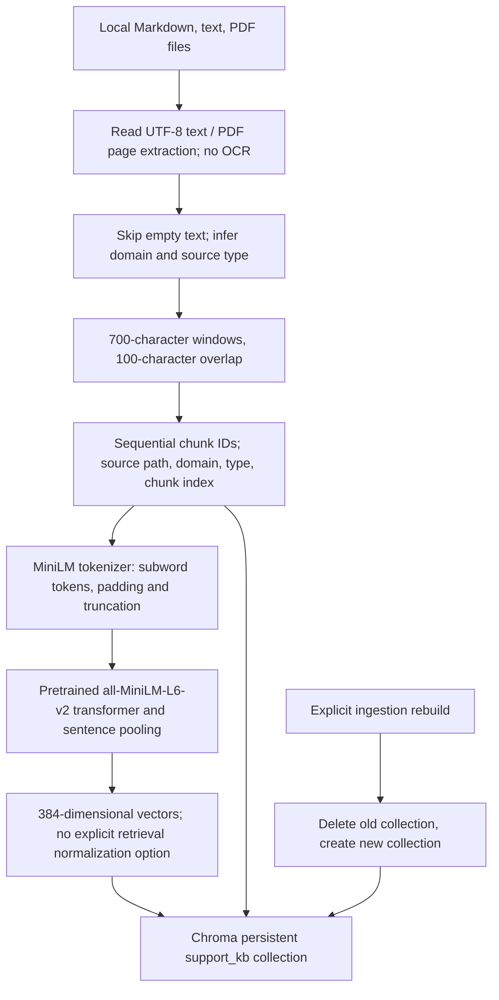
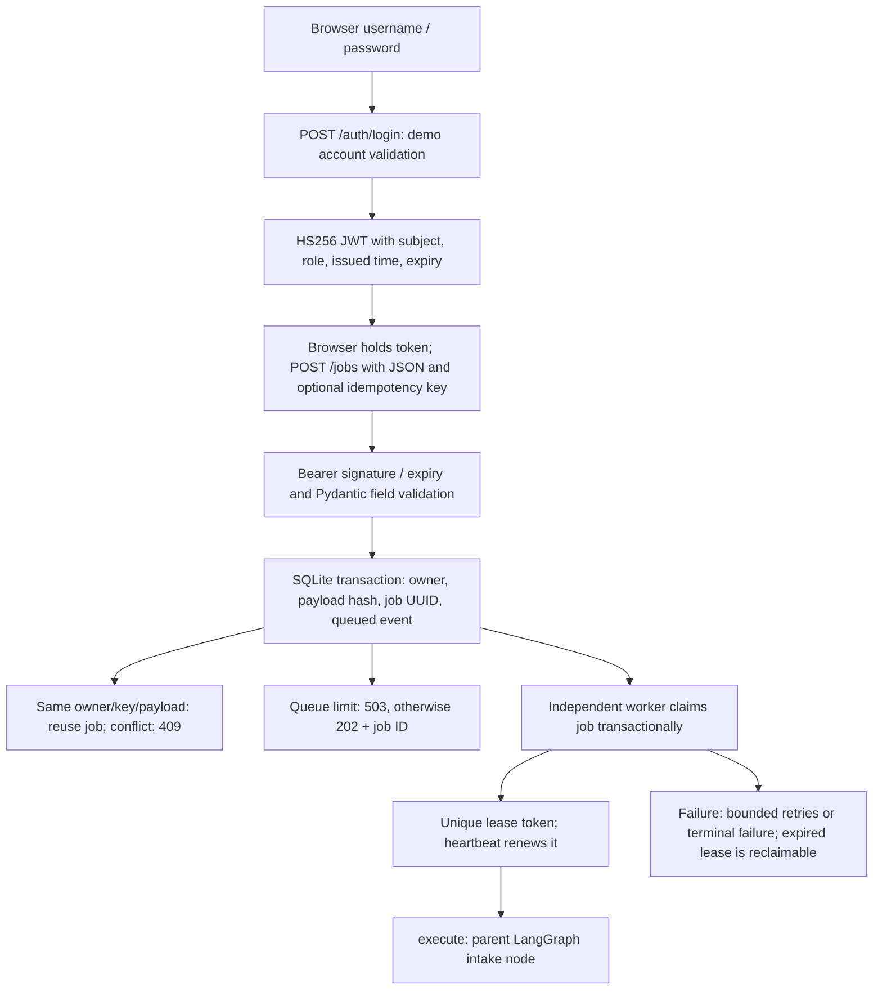
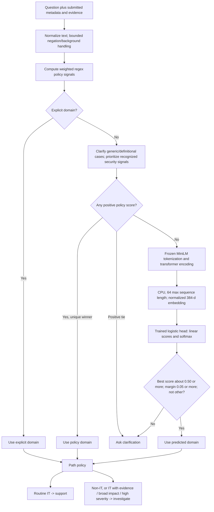
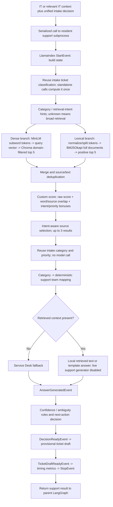
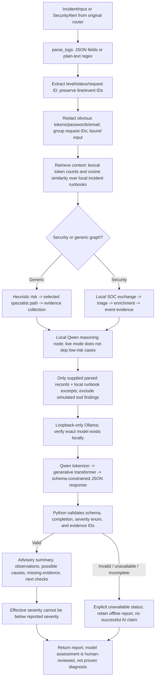
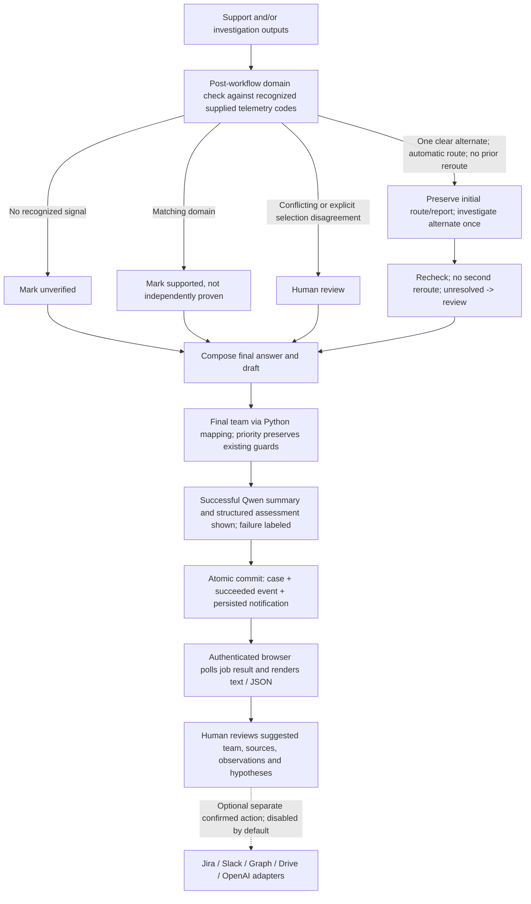

# Complete Request and Model Flow

## Current Top-Level Coordinator

All request classification and support/investigation execution now run under a parent LangGraph. See [the parent graph](PARENT_WORKFLOW.md) for its exact nodes and bounded Qwen ↔ LlamaIndex documentation exchange. The lower-level ingestion/retrieval steps below are unchanged. The parent final node calls the result composer; the API/job worker persists the result.

The domain routing policy and trained models are unchanged. A unified intake entry point now calls that policy plus the existing IT ticket model where applicable, and returns domain, workflow path, subcategory, priority, suggested team and retrieval hints together. The downstream support workflow consumes that decision without reclassifying. This is consolidation of existing models, not a new joint model or QLoRA deployment. Incident nodes parse supplied evidence and call local pretrained Qwen3 1.7B through Ollama; it is **not** the QLoRA classification adapter.

## 1. Build the Support Knowledge Index (Before Requests)

Tokenizer details are provided by SentenceTransformers/tokenizer defaults, not a handwritten tokenizer. Fixed character windows can cut a sentence. Rebuild is explicit, not automatic file watching; BM25 later searches loaded document text, not necessarily these chunks.

## 2. User, Authentication and Durable Work

Jobs are processed sequentially by this worker. The browser polls; it does not run the model. JWT signing material generated at API startup is for the demo, not a multi-instance production identity setup.

## 3. Unified Intake With Existing Domain Router

`intake_classifier.classify_intake()` owns the intake entry point. It calls the original domain policy below, then calls the resident support worker's classification-only operation once for IT/support-context requests. Pure non-IT requests have no invented IT subcategory. Clarification bypasses the ticket model. The response's `classification` field describes initial intake; post-workflow rerouting remains separately visible in `routing`.

Classifier IPC uses a resident subprocess and lock. With no usable model manifest the legacy TF-IDF path can apply; a loaded-worker failure does not silently substitute an LLM. This classifier is not used to diagnose an incident.

## 4. LlamaIndex Support Workflow (Unchanged)

Dense loading failures can leave BM25-only retrieval; unexpected Chroma errors can still propagate. This is not RRF or a neural reranker. Retrieval hints and the final ticket are derived from the same existing ticket-model prediction. The combined intake path bypasses the historical full-response FAQ cache so it cannot replace injected classification with stale ticket fields. Direct legacy `support(question)` calls retain that cache. Historical warm-cache throughput is not a benchmark of this new intake path. LlamaIndex support and incident workflows are now callable components inside the parent LangGraph.

## 5. LangGraph Incident Workflow With Local Qwen

The preexisting heuristic risk and graph status remain separate from the model's suggested severity. Neither is a probability of correctness. Metrics are parsed and supplied without inventing service thresholds. The model may still make unsupported semantic claims despite valid IDs. All model text is displayed as text, not executable markup or commands. No diagnostic command is executed by the model. Local tools in the earlier stages remain simulated and labeled, but are excluded from the model prompt. No automatic deeper tool loop is claimed.

## 6. Verification, Final Output and Optional Actions

The legacy POST /cases path executes synchronously and saves a case; it does not use the job queue. Its warm-cache benchmark is not a measurement of this new Qwen path.

## Running and Scope

From `platform/`, use `.venv-api/bin/python run_local.py`. The launcher defaults to `INCIDENT_ANALYSIS_MODE=ollama`, starts the installed user-local Ollama runtime if needed, binds it to loopback, disables cloud and limits it to one resident model/parallel request. It does not pull models automatically. Direct API imports default to offline unless that environment setting is provided, keeping offline tests reproducible. Set `INCIDENT_ANALYSIS_MODE=offline` for the older rule-only demo.

Local model: `qwen3:1.7b`. Optional permitted smaller tag: `qwen3:0.6b`; no automatic fallback or downloads. Runtime installed under `~/Library/Application Support/EnterpriseRAG/ollama/`; model stored under `~/.ollama/models/`. No paid endpoints, sign-in, or startup login service was installed. The Mac still supplies electricity, storage and shared CPU/GPU memory. A short localhost smoke test succeeded; it is not an answer-quality benchmark.

Security limitations: redaction is best-effort, not a student-data compliance guarantee; raw original case input remains in the local case store. Use synthetic/redacted evidence for demos. Prompts and local hosting do not solve prompt injection or eliminate hallucinations. Human review remains mandatory.

## Verification Performed

- Platform tests cover parser/model/graph contracts, unified intake, parent orchestration, domain-scoped runbooks and bounded documentation exchange. Two additional support tests verify that precomputed decisions bypass classification and standalone support classifies once. No live model is needed by CI; model responses there are simulated.
- One real direct synthetic incident completed with local Qwen in approximately 10.1 seconds (including graph work and initial model loading). This is a smoke test, not a latency benchmark.
- A separate real browser submission exercised login, HTTP 202, queue consumption, local Qwen, persistence and polling. Desktop/mobile browser checks found no JavaScript page errors or horizontal overflow.
- A later queued parent-graph test completed a real Qwen → LlamaIndex documentation lookup → Qwen reassessment in about 19.8 seconds on one synthetic production case. This is a functional smoke test, not a latency or answer-quality benchmark.
- The first router and MiniLM model selection were not edited. Historical classification, retrieval and 65,000-request warm-cache figures do not describe the new live model path.
- Download source: official Ollama release v0.40.16, with runtime SHA-256 verified against its published release digest. Qwen was pulled through the official Ollama registry and passed its digest verification. No third-party installer script, administrator install, cloud login or startup service was used.
