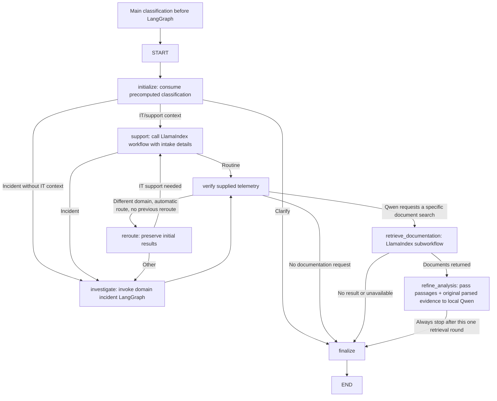

# Parent LangGraph and LlamaIndex Integration

FastAPI authenticates requests. The durable worker first calls the main `classify_intake()` entry point, then passes its result into `PlatformWorkflow.run(request, classification)`. LangGraph does not run initial classification again: it coordinates LlamaIndex support and Qwen-based incident investigation, route checking, requested documentation and final assembly.

## Responsibility Boundaries

- `platform_workflow.py`: parent state graph and conditional edges. Shared state carries the request, precomputed classification/result, provisional report, reroute count, retrieved documents and start time. Initialization only consumes classification.
- `intake_classifier.py`: the main classification stage before the graph, using unchanged models and domain policy. IT details and retrieval hints are computed once and reused downstream. QLoRA remains a domain-classification experiment; the generative investigation model is pretrained.
- `support/src/orchestrator.py`: LlamaIndex support subworkflow. It uses the precomputed ticket decision, hybrid support retrieval, offline support answer composition, confidence checks and draft preparation.
- Incident LangGraphs: parse logs/events, retrieve initial runbooks, run local domain handlers and optional live local Qwen synthesis. They are nested calls beneath the parent investigation node.
- `support/src/documentation_workflow.py`: an actual LlamaIndex event workflow that returns selected incident runbook candidates plus support retrieval where IT context applies. It does not run ticket classification or generate an answer again.
- `incident/app/services/local_analysis.py`: Qwen output has a bounded optional `documentation_query`. The model can propose a document search, not arbitrary tools, network targets or shell commands.
- `api.retrieve_documentation()`: scopes search using the already selected domain and existing local incident retriever, then passes candidates to the LlamaIndex worker. Document stores remain separate; this change unifies orchestration and the request interface, not storage.
- `api.refine_analysis()`: sends original parsed evidence IDs and the new document excerpts to local Qwen. It preserves the prior severity floor. New passages are guidance, not proof the incident happened.
- `api.compose_result()`: Python helper called by the parent's final node. It preserves support citations, team mapping, priority rules, and advisory model output. Nothing submits a ticket or notifies an external team automatically.

## Evidence and Failure Rules

The parent permits **one domain reroute** and **one additional documentation round**. A second model search request is recorded as budget-exhausted; it cannot loop. Documentation cannot fill missing live logs or metrics. Empty/failed retrieval keeps the original assessment. Invalid follow-up output also preserves the original assessment and exposes the failed follow-up status.

Model output must pass the existing JSON schema, evidence-reference and completion checks. These are structural checks, not semantic verification. Simulated tool findings are excluded from the Qwen prompt. All model output remains human-reviewed.

Both initial local incident retrieval and follow-up retrieval filter runbooks by the selected domain's metadata tags before selecting candidates. Generation is constrained to actual supplied evidence IDs; documents have a separate citation field and cannot serve as incident telemetry. This prevents mismatched identifiers and irrelevant cross-domain runbook context, not unsupported natural-language conclusions.

Job persistence and retries remain outside the workflow in the durable worker. Parent graph intermediate state is not newly checkpointed to a database; a retry may rerun the whole request. The existing ownership, JWT and confirmed external-action boundaries remain.

## Verification

Tests cover real parent graph construction, clarification, routine/incident routes, preservation of existing team/priority behavior, one-reroute fencing, exact forwarding of a model search request, a real LlamaIndex retrieval subworkflow, passing passages back to Qwen, and preservation of initial results after empty/failed retrieval or invalid follow-up.

The final platform suite passed **143 tests**. A real synthetic queued request completed the Qwen → LlamaIndex → Qwen round trip in approximately **19.8 seconds** on the local Mac. The returned context was the production runbook, and the model still identified the missing storage-specific retry procedure. This is a functional smoke test, not a diagnostic-accuracy or latency benchmark. Desktop/mobile browser checks also passed.

No new packages, models, cloud provider or paid service are required for this refactor. Existing Qwen classifier metrics and historical warm-cache throughput are not measurements of this new parent graph.
